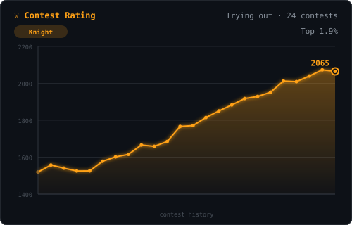

### `$ neofetch --full`

<picture>
  <source media="(prefers-color-scheme: dark)"  srcset="./assets/dark_mode.svg" />
  <source media="(prefers-color-scheme: light)" srcset="./assets/light_mode.svg" />
  
</picture>

 

<samp>
CS undergrad · building at the intersection of ML, backend systems, and agentic AI. 
Currently open to full-time roles and research collaborations — <a href="mailto:ashmitv704@gmail.com">let's talk</a>.
</samp>

---

## 📊 Activity Graph

> *Contribution heatmap*

<picture>
  <source media="(prefers-color-scheme: dark)"  srcset="./assets/contrib-heatmap-dark.svg" />
  <source media="(prefers-color-scheme: light)" srcset="./assets/contrib-heatmap-light.svg" />
  
</picture>

---

## 📟 GitHub Stats

> *`$ gh stats --verbose`*

---

## 🎹 Tech Stack

> *Keys I press daily*

---

## ⚔️ Competitive Programming

<table>
  <tr>
    <td align="center" width="50%">

</td>
    <td align="center" width="50%">

</td>
  </tr>
</table>

---

## 🛸 Projects

> *`$ ls -la ./projects/`*

---

<!--
## 🏆 Achievements

> *`$ cat achievements.log`*

-->

---

## 💼 Experience

> *`$ cat experience.json | jq '.[]'`*

<!--
---

## 📜 Certifications

> *`$ git log --all --format="%h %s" --certs`*

-->

---

&nbsp;

&nbsp;

Crafted with precision &amp; code · Ashmit Kumar Verma © 2026

*Building something with ML or backend systems? → [ashmitv704@gmail.com](mailto:ashmitv704@gmail.com)*

