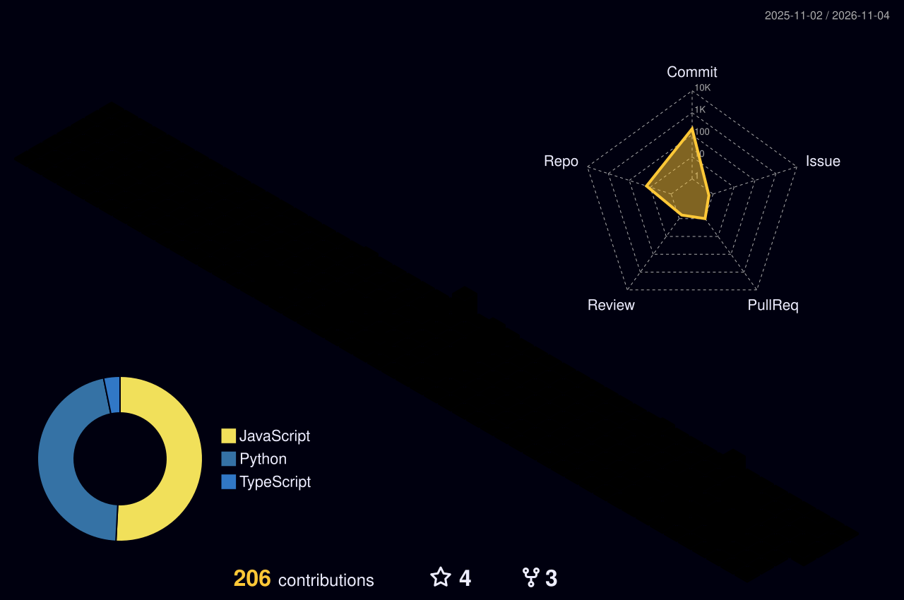

<div align="center">

<!-- ANIMATED TYPING HEADER -->


<!-- BADGE ROW -->
<p>
  <a href="https://www.linkedin.com/in/ashmit-kumar-verma"></a>
  <a href="https://leetcode.com/Trying_out"></a>
  <a href="https://codeforces.com/profile/Scarceflyer7"></a>
  <a href="mailto:ashmitv704@gmail.com"></a>
</p>

<!-- PROFILE VIEWS + FOLLOWERS -->
<p>
  
  
</p>

</div>

---

<!-- ════════════════════════════════════════
     §1  TERMINAL NEOFETCH CARD  (auto-generated SVG via GitHub Actions)
     ════════════════════════════════════════ -->

<div align="center">

### `$ neofetch --user ashmitv704`

<!--  The two SVGs below are auto-regenerated daily by .github/workflows/metrics.yml  -->
<!--  Light / dark mode toggle using GitHub's <picture> element                       -->

<picture>
  <source media="(prefers-color-scheme: dark)"  srcset="./assets/dark_mode.svg" />
  <source media="(prefers-color-scheme: light)" srcset="./assets/light_mode.svg" />
  
</picture>

</div>

---

<!-- ════════════════════════════════════════
     §2  ABOUT ME
     ════════════════════════════════════════ -->

<details open>
<summary><b>⚡ Boot Sequence — About Me</b></summary>
<br>

```text
$ cat about.txt
╔══════════════════════════════════════════════════════════════════╗
║  ashmit@bengaluru  ~  whoami                                     ║
╠══════════════════════════════════════════════════════════════════╣
║                                                                  ║
║  🎓  B.E. CSE (AI/ML) — M. S. Ramaiah Institute of Technology   ║
║      CGPA 9.46 | Bengaluru, India                                ║
║                                                                  ║
║  🔬  Researcher — MESA: Moment Enriched Self Attention           ║
║      (2nd Prize @ Scaler Rethesis)                               ║
║                                                                  ║
║  🏢  Ex-AI Engineer Intern @ Rtifact                             ║
║      GraphRAG · Neo4j · Multi-LLM Orchestration                  ║
║                                                                  ║
║  🏆  LeetCode Knight  |  Max Rating 2073  |  700+ solved         ║
║      Top 1% worldwide  |  Rank 417 / 27,000+ (Weekly 500)        ║
║                                                                  ║
║  🎯  Current obsession: Agentic AI + Knowledge Graphs            ║
║                                                                  ║
╚══════════════════════════════════════════════════════════════════╝
```

</details>

---

<!-- ════════════════════════════════════════
     §3  TECH STACK — 3-D KEYBOARD STYLE
     ════════════════════════════════════════ -->

## 🎹 Tech Stack

> Keys I press daily — inspired by the mechanical keyboard aesthetic

<div align="center">

<!-- ROW 1 — Languages -->
**Languages**

<br/><br/>

<!-- ROW 2 — ML / AI -->
**ML · AI · Research**

<br/><br/>

<!-- ROW 3 — Backend / Infra -->
**Backend & Infrastructure**

<br/><br/>

<!-- ROW 4 — Frontend / Tools -->
**Frontend & Tools**


</div>

---

<!-- ════════════════════════════════════════
     §4  GITHUB STATS GRID
     ════════════════════════════════════════ -->

## 📊 GitHub Stats

<div align="center">

<table>
  <tr>
    <td>
      
    </td>
    <td>
      
    </td>
  </tr>
  <tr>
    <td colspan="2" align="center">
      
    </td>
  </tr>
</table>

</div>

---

<!-- ════════════════════════════════════════
     §5  CONTRIBUTION GRAPH — TERMINAL STYLE
     ════════════════════════════════════════ -->

## 🌱 Activity Graph — Terminal Edition

> *Commit streaks live below — auto-updated nightly via GitHub Actions*

<div align="center">

<!-- Snake animation eats your contribution graph -->
<picture>
  <source media="(prefers-color-scheme: dark)"  srcset="./assets/github-snake-dark.svg" />
  <source media="(prefers-color-scheme: light)" srcset="./assets/github-snake.svg" />
  
</picture>

<br/>

<!-- Terminal-style contribution heatmap (auto-generated SVG) -->
<picture>
  <source media="(prefers-color-scheme: dark)"  srcset="./assets/contrib-heatmap-dark.svg" />
  <source media="(prefers-color-scheme: light)" srcset="./assets/contrib-heatmap-light.svg" />
  
</picture>

</div>

---

<!-- ════════════════════════════════════════
     §6  COMPETITIVE PROGRAMMING — SPLIT CARDS
     ════════════════════════════════════════ -->

## ⚔️ Competitive Programming

<div align="center">

<table>
  <tr>
    <td align="center" width="50%">

### 🟡 LeetCode

[](https://leetcode.com/ashmitv704)

**Knight 🏅** · Max Rating **2073** · **700+** solved

`Easy` ████████████░ `Medium` ██████████░ `Hard` ██████░

</td>
    <td align="center" width="50%">

### 🔵 Codeforces

[](https://codeforces.com/profile/ashmitv704)

<br/>


**Pupil** · Current Rating **1385**

</td>
  </tr>
</table>

<!-- LeetCode heatmap / streak -->
<br/>


</div>

---

<!-- ════════════════════════════════════════
     §7  PROJECTS
     ════════════════════════════════════════ -->

## 🛸 Projects

<div align="center">

<table>
  <tr>

<!-- Project Card 1 -->
<td width="50%" valign="top">

### 📈 FinSocial
**Full-stack NSE/BSE Paper Trading Platform**

```
Stack  →  React · FastAPI · PostgreSQL
         XGBoost · FinBERT · Socket.IO
         Nginx · Docker · Vercel
```
- 🤖 3-class XGBoost signal classifier (BUY/HOLD/SELL) trained on 10 yrs OHLCV + FinBERT sentiment — 52.8% precision vs 33% random
- 💬 RAG-backed AI chatbot (Gemini + pgvector)
- ⚡ Real-time WebSocket leaderboard & community forums
- 🚀 Microservices behind Nginx reverse proxy + CI/CD

[](https://github.com/ashmitv704/finsocial)

</td>

<!-- Project Card 2 -->
<td width="50%" valign="top">

### 🧠 SENTINEL
**Privacy-first LLM Message Classifier**

```
Stack  →  Python · Gemini / OpenAI / Claude
         Tesseract OCR · faster-whisper
         scikit-learn · TF-IDF
```
- 🛡️ 96.7% macro-avg accuracy (5-fold CV) — classify notify/digest/mute
- 🔒 On-device OCR/ASR — raw media never leaves device
- ⚡ Sub-10ms TF-IDF/LR classifier for prompt-injection & phishing
- 🗜️ Context compressed 60–95% before LLM call

[](https://github.com/ashmitv704/sentinel)

</td>

  </tr>
  <tr>

<!-- Project Card 3 -->
<td width="50%" valign="top">

### 🔗 SyncSpace
**Collaborative Resource-Sharing Platform**

```
Stack  →  React · Node.js · Express
         MongoDB · AWS S3 · Socket.IO
```
- 📁 Share links, files, notes, rich-text articles in real-time
- ✍️ Live threads + typing indicators via Socket.IO
- 🔑 JWT auth + RBAC with presigned AWS S3 URLs
- 🔗 Open Graph link previews

[](https://github.com/ashmitv704/syncspace)

</td>

<!-- Project Card 4 — Research -->
<td width="50%" valign="top">

### 🔬 MESA *(Research)*
**Moment Enriched Self Attention**

```
Domain →  NLP · Transformer Architecture
Venue  →  Scaler Rethesis (2nd Prize 🥈)
```
- 📐 Augments Q/K projections with learnable higher-order statistical moments via Cross-Moment Projection (CMP) module
- 🧪 Evaluated on AG News with multi-seed validation
- Co-authored independent research

[](https://github.com/ashmitv704)

</td>

  </tr>
</table>

</div>

---

<!-- ════════════════════════════════════════
     §8  EXPERIENCE TIMELINE
     ════════════════════════════════════════ -->

## 🏢 Experience

```text
  Jul 2026 ──────────────────────────────── Sep 2026
  │
  ├── 🤖  AI Engineer Intern @ Rtifact  (Remote / Bengaluru)
  │       • Graphify-native GitHub issue grounding engine
  │         → 70ms warm latency · 0.95 confidence · Python/FastAPI
  │       • 5-level prioritized signal cascade
  │         → 11,600+ nodes · 23,700+ edges (Neo4j graph)
  │       • 5-pass multi-tier extraction pipeline
  │         → Tree-sitter AST across 37 languages · OpenAI enrichment
  │       • AWS asset cartography platform
  │         → <50ms Neo4j Cypher mutations · <185ms per state-change
  │       • GraphRAG NLQ engine
  │         → FAISS semantic router · <30ms · zero LLM cost (50 Cypher templates)
  │
  Aug 2025 ──────────────────────────────── Sep 2025
  │
  └── 📡  Project Trainee @ Tata Communications  (Pune, India)
          • RESTful endpoints for Automated Incident Management System
          • New Relic + ServiceNow integration
          • Solution positioned to cut NOC triage staff: 5 → 1 engineer
```

---

<!-- ════════════════════════════════════════
     §9  ACHIEVEMENTS
     ════════════════════════════════════════ -->

## 🏆 Achievements

<div align="center">

| 🏅 Achievement | Details |
|:---|:---|
| **LeetCode Knight** | Worldwide **top 1%** · Max rating **2073** · **700+** problems solved |
| **Rank 417 / 27,000+** | LeetCode Weekly Contest 500 |
| **Codeforces Pupil** | Current rating **1385** |
| **Fidelity India Hackathon** | Finalist — Top 50 of 1200+ teams |
| **NER Tech 2.0** | Top 60 of 2000+ teams |
| **MSRIT Whackiest Hackathon** | Top 25 |
| **Scaler Rethesis** | 2nd Prize — MESA research paper |

</div>

---

<!-- ════════════════════════════════════════
     §10  3D CONTRIBUTION GRAPH
     ════════════════════════════════════════ -->

## 🌐 3D Contribution Globe

<div align="center">

<picture>
  <source media="(prefers-color-scheme: dark)"  srcset="./assets/profile-3d-contrib/profile-night-rainbow.svg" />
  <source media="(prefers-color-scheme: light)" srcset="./assets/profile-3d-contrib/profile-south-asia-light.svg" />
  
</picture>

</div>

---

<!-- ════════════════════════════════════════
     §11  CERTIFICATIONS
     ════════════════════════════════════════ -->

## 📜 Certifications & Learning

<div align="center">

| Provider | Course |
|:---:|:---|
|  | Transformers in Practice · ML Specialization · Agentic AI |
|  | DSA — Basics to Advanced |

</div>

---

<!-- ════════════════════════════════════════
     §12  FOOTER
     ════════════════════════════════════════ -->

<div align="center">

```text
╔══════════════════════════════════════════════════════════╗
║          Thanks for visiting — have a great day! 👾      ║
║  ashmitv704@gmail.com  |  Bengaluru, India               ║
╚══════════════════════════════════════════════════════════╝
```


<br/>

*⭐ Star something interesting? Feel free to reach out!*

</div>

